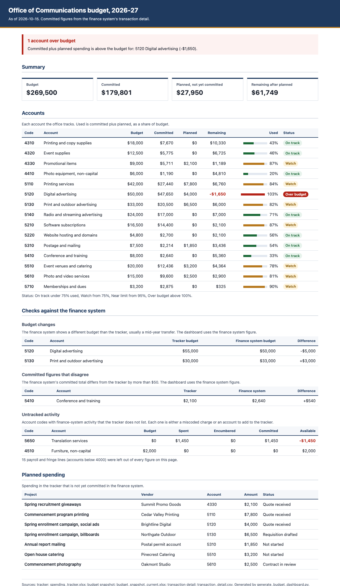

# Budget dashboard from a spending tracker and finance-system exports

A Python script that merges an office's own spending tracker with the finance system's exports
and renders one HTML page a leader can read: what each account has, what is
committed, what is planned, and which numbers don't agree. I'm Andrew Park, an executive
assistant in a college communications office. I built the original to produce budget dashboards
for the office's Executive Director and for myself, and she still relies on hers to get oriented.
I later moved my own tracking into a project tracker.

Everything in this repository is fictional. The office is the Office of Communications at
Cedar Ridge College, an invented school, and every account, vendor and dollar figure was made
up by the sample-data script.



## How it works

| Step | What happens | Sample file |
|---|---|---|
| 1. Tracker | The office keeps its own budget, committed figures and planned spending in Excel | [`spending_tracker.xlsx`](sample/sources/spending_tracker.xlsx) |
| 2. Budget snapshot | One finance-system export, one row per account, with the budget after mid-year transfers | [`budget_snapshot_current.xlsx`](sample/sources/budget_snapshot_current.xlsx) |
| 3. Transaction detail | A second export, one row per charge or purchase order | [`transaction_detail.csv`](sample/sources/transaction_detail.csv) |
| 4. Merge | The script decides which source wins for each figure and runs the checks below | [`generate_budget_dashboard.py`](scripts/generate_budget_dashboard.py) |
| 5. Page | One HTML file, readable on a laptop or printed | [`dashboard.html`](sample/dashboard.html) |

## The rules it follows

The tracker and the finance system each know something the other doesn't. The finance system
is right about money that has moved. The tracker is the only place that knows about spending
that is planned but not yet on a purchase order. So the script uses fixed rules about which
source wins:

- **Budget** comes from the budget snapshot when that export is present, because it includes
  transfers made during the year. Otherwise it comes from the tracker.
- **Committed** (spent plus encumbered) comes from the transaction detail when present, then from
  the budget snapshot, then from the tracker.
- **Payroll and fringe accounts** (codes below 4000) are left out of every figure. They are
  not part of the operating budget the office manages, and including them would bury the
  accounts that matter.

Then it flags what doesn't match:

- an account where committed plus planned spending is over budget
- an account where the finance system's budget differs from the tracker's
- an account where the finance system's committed total differs from the tracker by more than $50
- **untracked activity**: money the finance system shows on an account code the tracker doesn't
  list at all. That is either a charge coded to the wrong account or an account someone needs
  to start tracking, and both are easy to miss without a sweep.

In the sample, digital advertising is over budget once a planned ad buy is counted, two budgets
were moved by mid-year transfers, the tracker missed one conference registration, and a
translation charge landed on an account nobody tracks.

## When something is wrong, it stops

A dashboard built on a missing or misread export looks just as confident as a correct one. So
the script refuses to write a page rather than guess:

- No tracker, or neither finance-system export: exit code 3.
- Two files that both look like the same export (an old download left beside a new one): exit
  code 3, naming both files.
- An export whose columns have moved, or a figure that isn't a number: exit code 1, naming the
  file and row.

Exports are found by the start of their filename rather than an exact name, because the finance
system has renamed its downloads before.

## The same pattern elsewhere

The same pattern (pull exports, merge by rule, flag what doesn't match, render one page a leader
reads) makes a weekly pipeline pre-read for a revenue team: CRM exports in place of finance
exports, deal stages in place of accounts, and the same flags for figures that disagree.

## How it was built

I designed it and built it by directing Claude Code. The original also drew on other records
specific to my office, and those parts are left out here. What remains is the part that carries the judgment: the merge
rules, the exclusion, the untracked sweep and the checks. The page uses real headings, table
headers and text labels for each status, so a screen reader can navigate it and no status depends on
color alone.

## Run it yourself

You need Python 3 and `openpyxl`. `pytest` runs the tests.

```bash
pip install openpyxl pytest
python3 scripts/make_sample_data.py
python3 scripts/generate_budget_dashboard.py --sources sample/sources --output my_dashboard.html
python3 -m pytest tests
```

To use your own data, put a tracker and your exports in one folder with the same layout as the
sample files and point `--sources` at it. The office name and fiscal year are `--office` and
`--fiscal-year`.

## What's here

```
scripts/generate_budget_dashboard.py   reads the sources, merges them, writes the page
scripts/make_sample_data.py            writes the fictional sample sources
sample/sources/                        fictional tracker and finance-system exports
sample/dashboard.html                  the page rendered from the sample
tests/                                 tests for the merge rules, exclusion, sweep and failures
docs/                                  screenshot of the sample page
```

Released under the MIT License.
